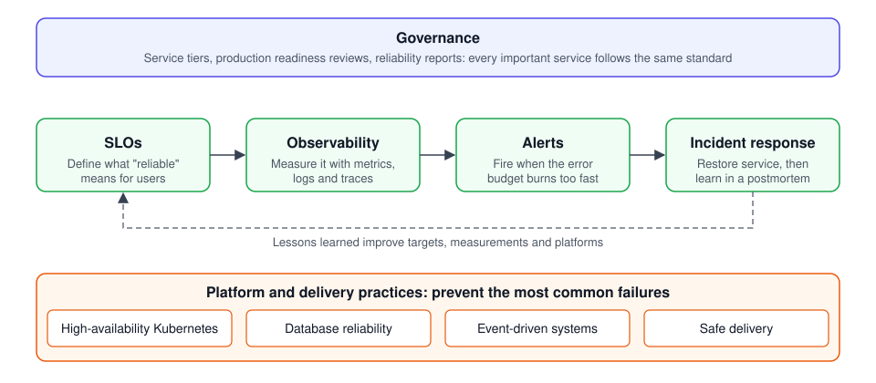

# Reliability Framework

**A practical, open guide to keeping online services dependable**: deciding
how reliable a service must be, measuring it, and acting before people are
affected.

[What is SRE?](#what-is-site-reliability-engineering) ·
[Where to start](#where-to-start) ·
[The eight modules](#the-eight-modules) ·
[Templates](#templates-and-tools) ·
[Glossary](docs/glossary.md)

---

## Why this exists

Hospitals, banks, government agencies and businesses depend on software that
runs in the cloud. When that software goes down, people cannot log in, pay,
file paperwork or reach their records.

Most outages are not caused by a lack of talent. They usually start with an
ordinary change or failure, and last longer or repeat because teams never
agreed on **how reliable a service needs to be**, never **measured** it in a
consistent way, or had **no plan** for what to do when reliability started to
slip.

This framework closes those gaps with short guides, checklists and
fill-in-the-blank templates that any team can adopt.

## What is site reliability engineering?

**Site reliability engineering (SRE)** is the discipline of keeping software
services dependable. It began at Google in 2003 and is now practised across
the industry. Its core idea is simple: treat reliability as an engineering
problem with measurable targets, rather than as a matter of hoping nothing
breaks.

In practice, SRE teams:

- **set targets** for how reliable each service must be, from the user's
  point of view;
- **measure** whether those targets are being met, continuously;
- **respond** to problems with a calm, rehearsed process;
- **learn** from every serious failure without blaming individuals;
- **prevent** the most common failures through proven designs and safe ways
  of releasing changes.

Each of these is a module in this framework.

## The key idea: reliability targets and error budgets

A **Service Level Objective (SLO)** is a written, measurable promise about a
service. For example:

> "99.9% of login requests in any 30-day period will succeed in under 300
> milliseconds."

That one sentence answers three questions everyone in an organization cares
about:

1. **What matters to users?** Logins that succeed, and are fast.
2. **How good is good enough?** 99.9%, which allows about 43 minutes of
   failure per month.
3. **How do we know?** It is measured automatically, all the time.

The small amount of allowed failure is called the **error budget**. While the
budget lasts, teams can ship new features quickly. When it runs out, the team
pauses risky changes and fixes reliability first. This turns "is the system
reliable enough?" from an argument into a number.

## Where to start

| If you are… | Read this first | Then |
| --- | --- | --- |
| **New to the subject** and want to understand it | This page, then the *In plain language* box at the top of each module | The [glossary](docs/glossary.md) whenever a word is unfamiliar |
| **A leader or manager** | [1. SLOs](slo/) and [8. Governance](governance/) | [3. Incident response](incident-response/), and the [adoption path](governance/README.md#adoption-path) |
| **An engineer** adopting this for a service | [1. SLOs](slo/) and [2. Observability](observability/) | The module for your platform, and the [templates](#templates-and-tools) |

Every module opens with a short plain-language summary, so you can read just
the first box of each one and come away with the whole picture in about ten
minutes.

## The eight modules

Read them in order for the full journey, or jump to the one you need.

| # | Module | The question it answers | Reading time |
| --- | --- | --- | --- |
| 1 | [Service Level Objectives](slo/) | How reliable does this service need to be, and how do we measure it? | 5 min |
| 2 | [Observability](observability/) | Can we see what is happening inside our systems? | 8 min |
| 3 | [Incident response](incident-response/) | When something breaks, who does what, and how do we learn from it? | 11 min |
| 4 | [Safe delivery](safe-delivery/) | How do we release changes without breaking things? | 7 min |
| 5 | [High-availability Kubernetes](kubernetes/) | How do we run software so a failed server or data center does not cause an outage? | 12 min |
| 6 | [Database reliability](database/) | How do we keep data safe and available? | 7 min |
| 7 | [Event-driven systems](event-driven/) | How do services pass messages without losing them or overwhelming each other? | 10 min |
| 8 | [Governance](governance/) | How does an organization make all of this routine? | 5 min |

### How they fit together

SLOs define what "reliable" means. Observability measures it. Alerts fire when
the error budget is being used up too fast. Incident response restores service
and feeds lessons back. The platform and delivery modules prevent the most
common failures in the first place, and governance makes sure every important
service follows the same standard.

## Templates and tools

Ready to copy and fill in. Each one explains its own fields.

| Template | Use it when | Module |
| --- | --- | --- |
| [SLO document](slo/templates/slo-document.md) | Agreeing reliability targets for a service | SLOs |
| [SLO file (`slo.yaml`)](slo/templates/slo.yaml) | Turning those targets into automatic alerts | SLOs |
| [Error budget policy](slo/templates/error-budget-policy.md) | Agreeing what happens when targets are missed | SLOs |
| [Runbook](incident-response/templates/runbook.md) | Writing the steps for responding to one alert | Incident response |
| [Status update](incident-response/templates/status-update.md) | Telling colleagues and customers what is happening | Incident response |
| [Postmortem](incident-response/templates/postmortem.md) | Reviewing an incident afterwards | Incident response |
| [CAST analysis](incident-response/templates/cast-analysis.md) | Digging deeper into a serious or repeated incident | Incident response |
| [Production readiness review](governance/templates/production-readiness-review.md) | Checking a service before real users rely on it | Governance |
| [Reliability report](governance/templates/reliability-report.md) | Reporting reliability to leadership | Governance |

**Worked example:** a complete, filled-in set of SLOs for a fictional
[checkout service](slo/examples/checkout-api/).

**Tool:** [`slo_tool`](tools/) checks an SLO file, calculates error budgets and
generates monitoring alerts from it.

## Design principles

- **Unobserved is unproven.** If something is not used or cannot be observed,
  there is no evidence it works. New versions and environments earn trust with
  real, measured traffic.
- **Plain language first.** Every module opens with a summary anyone can
  follow.
- **Vendor neutral.** Works with any cloud provider and any monitoring tool,
  built on open standards (OpenTelemetry, Prometheus, Kubernetes).
- **Built on established practice.** Follows the methods published in Google's
  *Site Reliability Engineering* and *The Site Reliability Workbook*, and
  Nancy Leveson's work on system safety at MIT.
- **Copy, fill in, done.** Templates are short and every field explains itself.

## About

**Author:** Matheus Lichtnow, Software Engineer ·
**Version:** 0.2, November 2026 ([changelog](CHANGELOG.md)) ·
**License:** [MIT](LICENSE), free for anyone to use, copy and adapt.

Suggestions and corrections are welcome as issues or pull requests.
