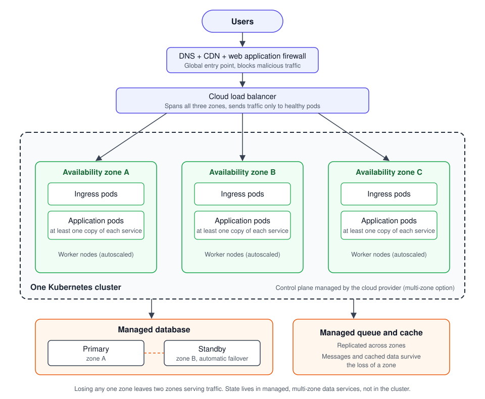

# High-Availability Kubernetes: Reference Architecture and Guidelines

A proven design for running critical services on Kubernetes so that the
failure of a server, a data center or a bad deployment does not become an
outage, plus guidelines for upgrading and migrating platforms safely.

## Summary for non-engineers

Kubernetes is the most widely used open-source system for running software in
the cloud. It can restart failed programs and spread them across many
machines, but only if it is configured correctly. Many organizations adopt it
and still suffer outages because of a handful of common configuration gaps.
This module describes the design and the specific settings that close those
gaps, along with a safe, repeatable method for upgrading or migrating
clusters without interrupting users.

## Reference architecture



The cluster's worker nodes run in three availability zones (A, B and C) of the
same region. Each zone holds at least one copy of every service, so losing an
entire zone still leaves two zones serving traffic.

**Principles**

1. **Spread across at least three availability zones.** A zone is one or more
   independent data centers. Losing one zone must not take down the service.
2. **Use the managed control plane** offered by the cloud provider, in its
   multi-zone form (for example Amazon EKS; a GKE regional cluster, not a
   zonal one; Azure AKS with availability zones on a tier with an uptime SLA),
   rather than running it yourself.
3. **Keep state out of the cluster** where possible. Databases, queues and
   object storage run as managed, multi-zone services. Pods are disposable.
4. **Everything as code.** Clusters are created with infrastructure as code
   (Terraform, OpenTofu, Pulumi or similar). Workloads are deployed through
   GitOps (Argo CD, Flux) so the Git repository is the single source of truth.
5. **Plan for the next cluster.** Design so a whole cluster can be replaced,
   which makes upgrades, migrations and disaster recovery the same routine
   operation.

## Workload configuration checklist

These settings prevent the most common Kubernetes outages. An annotated
example manifest is in [`example-deployment.yaml`](example-deployment.yaml)
(items 1 to 12).

| # | Setting | Why |
| --- | --- | --- |
| 1 | **At least 3 replicas** for user-facing services (set as the autoscaler minimum; do not set `replicas` in Git for autoscaled workloads, or GitOps resets the live count on every sync) | One replica down for maintenance and one failing still leaves capacity |
| 2 | **Topology spread constraints**: a hard rule across zones that ignores unreachable nodes (`nodeTaintsPolicy: Honor`) and spreads each version separately (`matchLabelKeys: [pod-template-hash]`), plus a soft rule across nodes | Guarantees replicas in every zone, even during a rollout, and spreads them across machines where possible. Without `Honor`, a lost zone blocks new pods in the surviving zones. Confirm in a zone-failure exercise that replacements land in the surviving zones |
| 3 | **PodDisruptionBudget**, with `unhealthyPodEvictionPolicy: AlwaysAllow` | Stops node upgrades and autoscaling from evicting too many replicas at once, without letting crash-looping pods block drains |
| 4 | **Readiness probe** that checks whether this pod can serve, not shared dependencies | Traffic only reaches pods able to serve; a slow shared dependency such as the database must not take every pod out of rotation at once |
| 5 | **Liveness probe**, conservative, and never checking dependencies | Restarts stuck processes without causing restart storms when a database is slow |
| 6 | **Startup probe** for slow-starting apps | Prevents liveness checks from killing apps still booting |
| 7 | **CPU and memory requests** on every container; **memory limit** set | Lets the scheduler place pods correctly and prevents one pod starving others |
| 8 | **Graceful shutdown**: handle SIGTERM, `preStop` delay, adequate `terminationGracePeriodSeconds` | Requests in flight finish during deploys instead of failing |
| 9 | **Rolling update** with `maxUnavailable: 0` | Capacity never drops during a deploy |
| 10 | **Autoscaling with a sensible minimum and maximum**, using KEDA or the Horizontal Pod Autoscaler (see [Choosing an autoscaler](#choosing-an-autoscaler)) | Absorbs traffic spikes without paying for peak capacity all the time |
| 11 | **Run as a numeric non-root user, read-only root filesystem (with a writable `/tmp` volume), drop capabilities** | Limits the damage of a compromised container |
| 12 | **Immutable image tags or digests** | What is tested is exactly what runs |
| 13 | **Many moderately sized nodes, not a few very large ones**; spread pods so no single node holds a large share of any service | Nodes will fail, and they are also replaced routinely (operating system image updates, autoscaler consolidation). Losing or draining a node that holds most of the pods is a dramatic event; losing one of many is routine |
| 14 | **Service mesh with rate limiting** on both incoming traffic (north-south) and service-to-service traffic (east-west) | One noisy client or runaway internal caller cannot overwhelm a service. The mesh also adds mutual TLS, timeouts and retries in one place. Per-proxy limits scale with replica count; global limits need a rate-limit service that fails open. Bound retries with retry budgets, and make sure the sidecar outlives the app during shutdown (native sidecars, Kubernetes 1.29+) |
| 15 | **Match the node capacity type to the workload.** User-facing services (web servers, APIs) run on on-demand nodes in dedicated node pools, never on spot instances. Spot capacity is for interruptible work (batch jobs, CI). Limit how often the autoscaler replaces nodes just to repack pods (disruption budgets, consolidation settings; see [the Karpenter example](#example-dedicated-on-demand-node-pool-karpenter)) | Spot instances can be reclaimed at any time, causing constant churn for services that must stay up. Dedicated node pools, taints and node selectors keep each workload on the right kind of node |
| 16 | **Spare capacity with low-priority "pause" pods** (overprovisioning) | Placeholder pods hold ready, empty capacity. When real pods need room, the placeholders are evicted instantly and the real pods schedule in seconds, instead of waiting minutes for a new node. Example: [`example-overprovisioning.yaml`](example-overprovisioning.yaml) |

### Choosing an autoscaler

- **KEDA** (Kubernetes Event-driven Autoscaling) is the right default for
  most teams. It scales on the signal that actually reflects demand: queue
  length or message age, stream lag, a Prometheus query (such as request rate
  or latency), a schedule, and dozens of other sources. It can also scale
  idle workloads to zero. Under the hood it creates and drives a standard
  Horizontal Pod Autoscaler, so it adds capability without replacing the
  built-in mechanism.
  - Its `minReplicaCount` defaults to 0: set it to at least 3 for user-facing
    services. Scale to zero is for background workers.
  - One autoscaler per workload: never define an HPA and a KEDA ScaledObject
    for the same Deployment.
  - Set `fallback` so a broken metric source holds a safe replica count, and
    run KEDA itself highly available.
- **The plain Horizontal Pod Autoscaler** is enough for simple
  request-driven services where CPU usage tracks load closely (memory rarely
  does, because it is not released when load drops). It needs only the
  metrics server.

Whichever is used, set a minimum that keeps the service highly available
(item 1) and a maximum that downstream dependencies, such as the database,
can handle. Leave headroom in the target: at a 65% CPU target, losing one zone
of three pushes the remaining pods to about 98%.

### Example: dedicated on-demand node pool (Karpenter)

Item 15 in practice. User-facing pods select this pool and tolerate its taint.
Nodes are replaced when they expire (`expireAfter`, default 720 hours) and
whenever their configuration drifts, for example when a new node image is
released, so pin image versions rather than tracking "latest".

```yaml
apiVersion: karpenter.sh/v1
kind: NodePool
metadata:
  name: on-demand-web
spec:
  template:
    spec:
      requirements:
        - {key: karpenter.sh/capacity-type, operator: In, values: ["on-demand"]}
      taints:
        - {key: workload-class, value: web, effect: NoSchedule}
      expireAfter: 720h
      terminationGracePeriod: 4h   # after this, pods are force-deleted even if PDBs block
      nodeClassRef: {group: karpenter.k8s.aws, kind: EC2NodeClass, name: default}
  disruption:
    consolidationPolicy: WhenEmptyOrUnderutilized
    consolidateAfter: 30m          # don't repack nodes the moment load dips
    budgets:
      - nodes: "1"                 # replace at most one node at a time
      - {nodes: "0", reasons: ["Underutilized"], schedule: "0 8 * * mon-fri", duration: 10h}  # no repacking during business hours
```

## Cluster-level guidelines

- **Node groups** across all zones, with cluster autoscaling (Karpenter or
  Cluster Autoscaler; with Cluster Autoscaler, one node group per zone and
  `--balance-similar-node-groups`). Keep spare capacity so a lost zone can be
  rescheduled (see item 16).
- **Priority classes** so user-facing services outrank batch work when
  capacity is short.
- **Load balancer readiness gates** when the cloud load balancer sends traffic
  straight to pod IPs (for example the AWS Load Balancer Controller in IP
  mode); otherwise a rollout can remove old pods before the load balancer has
  registered the new ones.
- **Separate system workloads** (ingress, DNS, monitoring) onto dedicated
  nodes so application load cannot starve them.
- **CoreDNS and ingress** scaled for peak and covered by
  PodDisruptionBudgets; DNS failures look like everything failing at once.
- **NodeLocal DNSCache** on every node: a DNS cache running as a DaemonSet
  answers most lookups locally, so pods are shielded from CoreDNS latency,
  overload and packet loss, and CoreDNS handles far less traffic. It becomes a
  per-node dependency, so roll out changes to it carefully.
- **Network policies** default-deny between namespaces, with explicit allows.
- **Secrets** from a managed secret store, never committed to Git in plain
  text.
- **Admission policies** (Kyverno, OPA Gatekeeper) enforce this checklist
  automatically, so new services cannot skip it.
- **Backups** of cluster configuration are the Git repository; backups of data
  belong to the managed data services (see [Database reliability](../database/)).

## Upgrading and migrating safely

Kubernetes releases a new minor version roughly three times a year and each is
supported for a limited time, so upgrades are routine work, not a project.

**In-place upgrades** (control plane, then node groups) suit minor version
steps when the checklist above is in place:

1. Read the release notes for removed APIs; scan manifests with a tool such as
   `kubent` or `pluto`.
2. Upgrade a non-production cluster first and run it for at least a week.
3. Check each add-on's compatibility matrix and upgrade any that do not yet
   support the target version (often the node autoscaler) before the control
   plane. Upgrade one minor version at a time; nodes may lag the control plane
   but never lead it.
4. Upgrade the control plane, then the remaining add-ons (CNI, DNS, ingress).
5. Roll node groups one zone at a time, watching SLO dashboards between
   steps. PodDisruptionBudgets keep capacity up.

A control-plane minor upgrade is usually one-way on managed services: its
rollback plan is failing over to another cluster or fixing forward, which is
why risky jumps use blue/green.

**Blue/green cluster migration** suits large changes: a new cloud account, a
new region, a move from self-managed to managed Kubernetes, or several version
steps at once. It also applies to the **operators and add-ons that run the
cluster itself**, which can fail every workload at once: a major upgrade of
the node autoscaler (for example Karpenter), replacing the network layer (CNI)
or the service mesh, or changing how ingress works. These are safer done by
building a new cluster with the new setup and shifting traffic than by
changing the running cluster in place.

1. Build the new ("green") cluster entirely from code.
2. Deploy all workloads to it through GitOps. Keep background work that
   touches shared state (queue consumers, CronJobs, controllers such as
   external-dns or cert-manager) scaled to zero or suspended in green until
   cutover, so nothing runs twice and each external resource has one owner.
   Verify the basics with synthetic traffic.
3. Shift real traffic gradually with weighted DNS or the load balancer:
   1% → 10% → 50% → 100%, holding at each step while SLOs stay green. An idle
   green cluster emits no meaningful telemetry, so it is not proven until it
   serves real traffic (see [Safe delivery](../safe-delivery/README.md#core-principle-unobserved-is-unproven)).
   Judge green on its own metrics, labelled by cluster: at 1% of traffic it
   could fail every request while the service-wide burn rate stays below the
   page threshold. Before the large steps, pre-scale green to blue's current
   replica counts. DNS weights are approximate (resolver caching, long-lived
   connections), so lower DNS TTLs days ahead, or use a load balancer in front
   of both clusters for exact, fast shifts.
4. Keep the old ("blue") cluster running, with its minimum replicas pinned at
   peak, ready for rollback until the new one has run a full business cycle at
   full traffic (for example a week that includes the busiest day).
5. Decommission the old cluster.

**Rules for every upgrade or migration**

- Never during peak hours or a change freeze.
- A written rollback plan, tested before starting.
- Stop and roll back if the error budget burn rate crosses the
  [page threshold](../slo/README.md#step-5-alert-on-burn-rate-not-on-every-error).
- Record the change so it shows on dashboards.

## Disaster recovery

| Scenario | Design response | Target |
| --- | --- | --- |
| Node failure | Replicas on other nodes; autoscaler replaces the node | Brief errors for requests in flight; retries and mesh outlier detection hide most |
| Zone failure | Topology spread, spare capacity, multi-zone data stores | No user impact or brief degradation |
| Bad deployment | A rolling update with `maxUnavailable: 0` stalls instead of replacing healthy pods; the pipeline or a progressive delivery tool rolls back automatically on failed analysis or SLO burn (see [Safe delivery](../safe-delivery/README.md#2-canary-deployments)) | Minutes |
| Control plane outage | Running workloads keep serving; nothing can deploy or scale until it returns | Provider SLA; avoid changes until restored |
| Cluster failure | Rebuild from code, or fail over to a standby cluster | Defined RTO, tested twice a year |
| Region failure | Standby region for critical services, if business needs justify the cost | Defined RTO/RPO |

RTO (recovery time objective) is how long recovery may take; RPO (recovery
point objective) is how much recent data may be lost. Both are set with the
business and tested with real exercises, not assumed.
